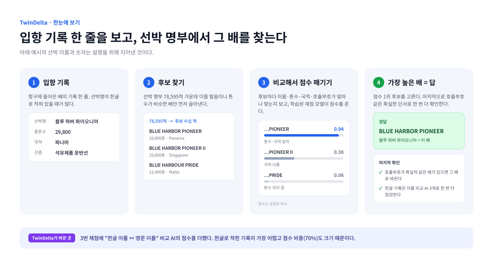
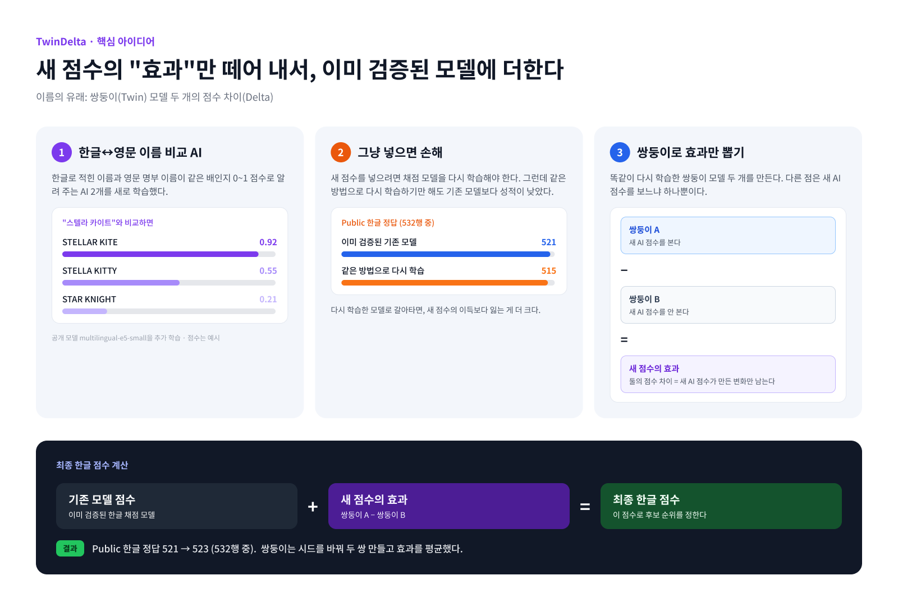
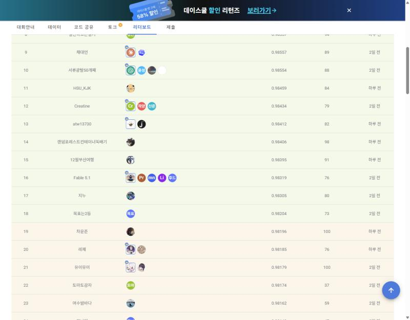
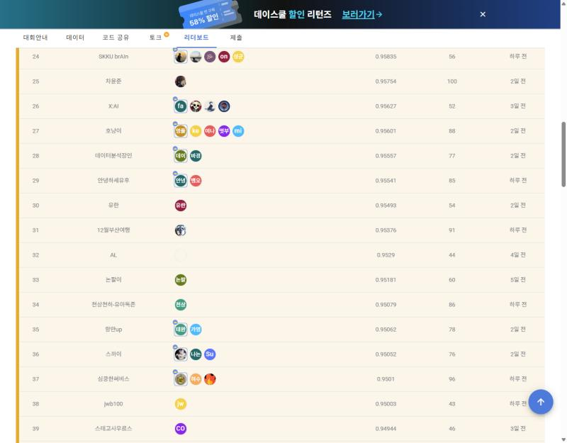

# TwinDelta: 입항 기록 한 줄로 어느 배인지 맞히기

DACON [항만 문제해결을 위한 AI 기술 공모전](https://dacon.io/competitions/official/236771/overview/description)(2026-10-12 ~ 2026-11-02)에 팀 **12월부산여행**으로 참가해 최종 선택한 모델 **TwinDelta**의 코드와 설명이다.

| 구분 | 점수 | 순위 |
|---|---|---|
| Public | 0.98395 | 15위 |
| **Private (최종)** | **0.95376** | **31위** / 1,113명 |

## 무엇을 하는 모델인가

항구에 들어온 배의 기록 한 줄(선박명, 톤수, 국적 등)을 보고, 선박 명부 78,595척 가운데 어느 배인지 맞힌다.

가장 어려운 것은 **한글로 적힌 이름**이다. `블루 하버 파이오니어`라는 기록을 영문 명부의 `BLUE HARBOR PIONEER`와 이어야 한다. 대회 점수의 70%가 이런 한글 기록에서 나온다.

## 한눈에 보기



## TwinDelta의 핵심 아이디어



1. 한글 이름과 영문 이름이 같은 배인지 판단하는 AI를 새로 만들었다.
2. 이 점수를 쓰려고 채점 모델을 다시 학습하면, 다시 학습하는 것만으로 성적이 떨어졌다.
3. 그래서 쌍둥이 모델 두 개의 점수 차이로 **새 점수의 효과만** 뽑아, 기존 모델에 더했다.

더 자세한 설명은 [docs/MODEL.md](docs/MODEL.md)에 있다. 그림 원본은 [Figma](https://www.figma.com/design/n0plCtIiRWEjSv66hZD1K0)에 있다.

## 리더보드

| Public 15위 | Private 31위 (최종) |
|---|---|
|  |  |

2026-11-02 DACON 리더보드 화면이다. 서버 추론 시간은 12분 36초(제한 30분)이고, 인터넷이 없는 환경에서 실행된다. 자세한 기록: [results/README.md](results/README.md)

## 저장소 안내

| 보고 싶은 것 | 위치 |
|---|---|
| 모델 자세히 보기 | [docs/MODEL.md](docs/MODEL.md) |
| 실행하고 재현하기 | [docs/REPRODUCE.md](docs/REPRODUCE.md) |
| 제출한 추론 코드 | [`submission/`](submission/) |
| 학습 코드 (참고용) | [`training/`](training/) |
| 제출 ZIP 만드는 스크립트 | [`packaging/`](packaging/) |
| 데이터 형식 예시 (가상 데이터) | [`samples/`](samples/) |
| 점수·순위·해시 기록 | [`results/`](results/) |
| 대회 규정을 지킨 내용 | [docs/COMPLIANCE.md](docs/COMPLIANCE.md) |

## 실행

```bash
python submission/script.py
```

- `data/` 폴더에 대회 데이터를 두고 실행하면 `output/submission.csv`가 생긴다.
- 학습된 모델 파일(`artifacts.joblib`, `e5ko/`, `e5kob/`)은 저장소에 없다. 원본 제출 ZIP(`hdeltaB_e5_e08_noLLM.zip`)에서 꺼내 `submission/model/`에 둔다.

## 공개 범위

- 대회 데이터, 학습된 모델 파일, 제출 ZIP은 올리지 않았다. 대신 SHA-256 해시를 [results/MANIFEST.json](results/MANIFEST.json)에 남겼다.
- 예시 데이터와 그림 속 선박 이름은 모두 지어낸 것이다.
- 코드의 주석과 변수 이름은 제출 당시 그대로(주로 영어)이고, 설명 문서는 한국어다.
