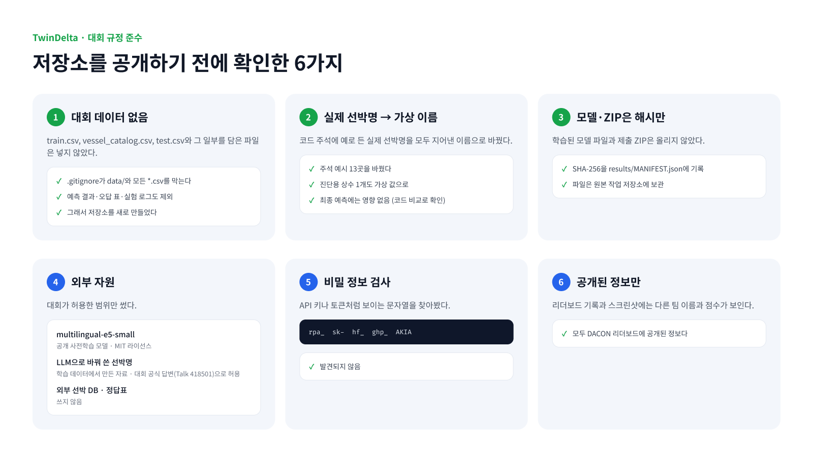

# 대회 규정 준수

## 1. 대회 데이터 없음

- 대회 데이터(`train.csv`, `vessel_catalog.csv`, `test.csv`)는 넣지 않았다. `.gitignore`가 `data/`와 모든 `*.csv`를 막고, 필요한 CSV만 예외로 허용한다.
- 대회 데이터의 행이나 그 일부를 담은 파일(예측 결과, 오답 분석 표, 실험 로그 등)도 넣지 않았다. 원본 작업 저장소에는 이런 파일이 265개 있어서 이 저장소를 새로 만들었다.
- [`samples/`](../samples/)의 예시 데이터는 모두 지어낸 것이다. 만든 뒤 가상 선박명과 호출부호가 실제 데이터에 없는지 대조했다.

## 2. 코드 속 실제 선박명 → 가상 이름

제출 코드 주석에 알고리즘 설명용으로 든 실제 선박명을 모두 가상의 이름으로 바꿨다.

| 파일 | 바꾼 곳 |
|---|---|
| `submission/model/src/translit.py` | 발음 키 예시 2곳 (예시 값도 실제 함수 출력으로 다시 계산) |
| `submission/model/src/en2ko.py` | 음역 규칙 예시 1곳 |
| `submission/model/src/models/ranked.py` | 선박명 변경 예시 1곳 |
| `submission/model/src/rank/candidates.py` | 오타 예시 1곳, 숫자 표기 예시 2곳 |
| `submission/model/src/rank/finetune.py` | 오타·선박명 변경 예시 2곳 |
| `submission/model/src/rank/synth_v6.py` | 한글 선박명 숫자 표기 예시 4곳 |
| `submission/model/src/rank/pipeline.py` | 진단용 상수 `PROBE_WRONG`의 실제 선박 번호를 가상 값으로 (설명 주석도) |

**예측에 미치는 영향: 없음.** 원본 ZIP 코드와 문법 트리를 비교했다(주석·문서 문자열 제외).

- 24개 파일은 바이트까지 같고, 6개 파일은 주석만 다르다.
- `pipeline.py`는 `PROBE_WRONG` 상수 하나만 다르다. 이 상수는 진단용 "probe" 모드에서만 쓰이고, 최종 제출에서는 이 모드가 꺼져 있다.

## 3. 모델과 제출 파일은 해시만

- 제출 ZIP, 학습된 채점 모델, 이름 비교 AI 가중치는 넣지 않았다. SHA-256을 [`results/MANIFEST.json`](../results/MANIFEST.json)에 남겼다.
- 파일은 원본 작업 저장소(로컬 Git LFS, 원격 없음)에 보관한다.

## 4. 외부 자원

| 자원 | 내용 |
|---|---|
| `intfloat/multilingual-e5-small` | 공개 사전학습 모델, MIT 라이선스 |
| LLM으로 바꿔 쓴 선박명 | 학습 데이터의 선박명을 다른 표기로 바꿔 쓴 자료(Qwen3.8-Flash-Next). 대회 공식 답변(Talk 418501)에서 허용된 방식이다. 대회 데이터에서 파생된 자료라 공개하지 않는다 |
| 외부 선박 DB, 정답표 | 쓰지 않음 |

## 5. 비밀 정보

공개 전에 API 키·토큰 형식의 문자열(`rpa_`, `sk-`, `hf_`, `ghp_`, `AKIA`로 시작)을 검사했고, 발견되지 않았다.

## 6. 공개된 정보만

리더보드 기록(`results/leaderboard_*.csv`)과 스크린샷에는 다른 팀의 이름과 점수가 보인다. 모두 DACON 리더보드에 공개된 정보다.
