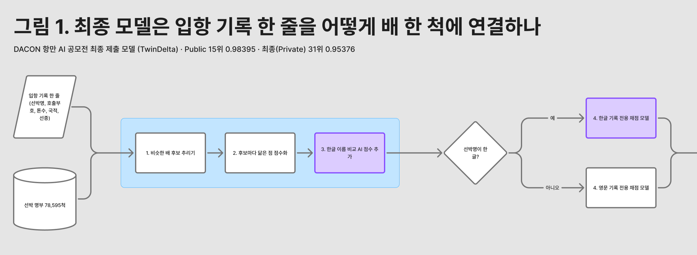
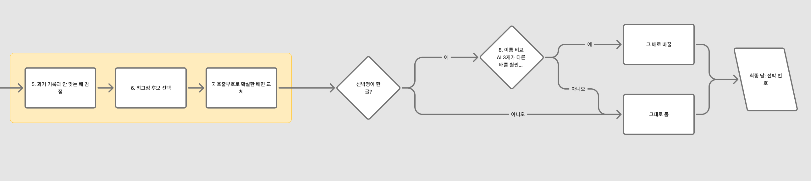
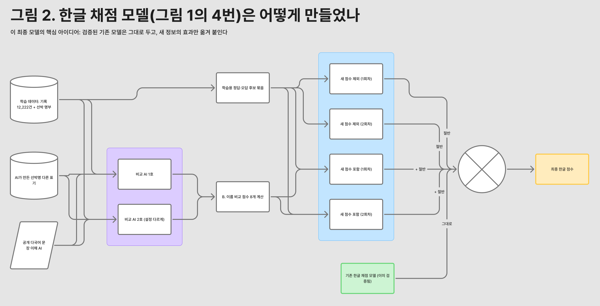

# TwinDelta 모델 설명

> **세 줄 요약**
> 1. 기록 한 줄마다 비슷한 배를 수십 척 추리고, 하나씩 비교해 점수를 매긴 뒤 1등을 답으로 고른다.
> 2. 한글로 적힌 기록을 위해, 한글 이름과 영문 이름을 비교하는 AI 2개를 새로 학습했다.
> 3. 이 AI 점수를 그냥 넣지 않고, 쌍둥이 모델의 점수 차이로 **효과만** 뽑아 검증된 기존 모델에 더했다.

| 항목 | 내용 |
|---|---|
| 모델 이름 | TwinDelta (쌍둥이 모델의 점수 차이에서 따온 이름) |
| 제출 파일 | `hdeltaB_e5_e08_noLLM.zip` (DACON 제출 ID 122968, 2026-11-01 01:51 KST) |
| 점수 | Public 0.98395 (15위), **Private 0.95376 (31위, 최종)** |
| 추론 | 12분 36초 (제한 30분), 인터넷 없음, 추론 때 LLM 안 씀 |
| ZIP | 790,664,745 bytes, SHA-256 `1fd1694a6cc6dfeffb145caa579b5c5b230e55cb38fdec1b1cc31a8a1a4dfe09` |

## 목차

1. [과제](#1-과제)
2. [전체 흐름 8단계](#2-전체-흐름-8단계)
3. [한글 채점 모델: TwinDelta의 핵심](#3-한글-채점-모델-twindelta의-핵심)
4. [한글↔영문 이름 비교 AI](#4-한글영문-이름-비교-ai)
5. [학습 데이터와 규정](#5-학습-데이터와-규정)
6. [결과와 한계](#6-결과와-한계)

## 1. 과제

입출항 기록 한 줄(선박명, 호출부호, 총톤수, 국제총톤수, 국적, 선종, 입항연도)을 보고 선박 명부 78,595척 중 어느 배(`vessel_id`)인지 맞힌다.

- 점수 = 0.7 × 한글 선박명 기록 정확도 + 0.3 × 영문 선박명 기록 정확도
- 한글 기록은 명부의 영문 이름과 표기가 달라서 가장 어렵고, 점수 비중도 크다.
- 기록 한 줄은 다른 기록을 참고하지 않고 따로 예측해야 한다.

## 2. 전체 흐름 8단계





| 단계 | 하는 일 | 코드 |
|---|---|---|
| 1. 후보 추리기 | 톤수가 비슷한 배, 이름 발음이나 단어가 비슷한 배, 이름 비교 AI가 가깝다고 본 배를 모아 한 줄당 수십 척으로 좁힌다 | `rank/candidates.py` |
| 2. 비교 값 계산 | 후보마다 이름이 얼마나 비슷한지, 톤수 차이, 호출부호 일치, 국적·선종 일치를 계산한다 | `rank/pipeline.py` |
| 3. 이름 비교 AI 점수 추가 | **TwinDelta에서 새로 넣은 부분.** 한글 기록이면 AI 2개가 후보마다 4개씩, 비교 값 8개를 더한다([4절](#4-한글영문-이름-비교-ai)) | `rank/e5feat.py` |
| 4. 채점 | 한글 기록과 영문 기록을 각자 전용 순위 모델이 채점한다. 과거 데이터에서 "정답 배는 비교 값이 이렇더라"를 배운 모델이다 | `rank/rankers.py`, `rank/bagrank.py` |
| 5. 감점 규칙 | 학습 데이터에 나온 배인데 호출부호와 이름이 그 배의 과거 기록과 하나도 안 맞으면 크게 감점한다 | `rank/train_memory.py` |
| 6. 1등 고르기 | 점수가 가장 높은 후보를 답으로 고른다 | `rank/pipeline.py` |
| 7. 호출부호 확인 | 호출부호가 학습 데이터에서 딱 한 척에만 쓰였고 이름도 25% 이상 비슷하면 그 배로 확정한다 | `rank/train_memory.py` |
| 8. 한글 기록 최종 점검 | 이름 비교 AI 3개의 합산 점수로 볼 때 지금 답보다 훨씬(기준값 1.0 초과) 가까운 배가 있으면 그 배로 바꾼다. 영문 기록은 그대로 둔다 | `rank/submission_variant.py` |

코드 경로는 `submission/model/src/` 기준이다. 모든 단계는 기록 한 줄 안에서만 계산한다. 기록 순서를 바꾸거나 일부만 넣어 실행해도 결과가 같은지 확인했다.

## 3. 한글 채점 모델: TwinDelta의 핵심



**문제.** 새 이름 비교 AI의 점수를 쓰려면 한글 채점 모델을 다시 학습해야 한다. 그런데 같은 방법으로 다시 학습하기만 해도, 이미 검증된 기존 모델보다 Public 한글 정답이 6행 적었다(515 대 521, 532행 중).

**해결.** 다시 학습한 모델로 갈아타지 않고, 새 점수의 **효과만** 기존 모델에 더한다.

```
최종 한글 점수 = 기존 모델 점수
              + 0.5 × (쌍둥이 A − 쌍둥이 B)   ← 시드 0,1로 학습한 한 쌍
              + 0.5 × (쌍둥이 A − 쌍둥이 B)   ← 시드 2,3으로 학습한 한 쌍
```

| 이름 | 무엇인가 |
|---|---|
| 기존 모델 | 이미 검증된 한글 순위 모델(LightGBM lambdarank). 전체 학습 데이터로 학습했다 |
| 쌍둥이 A | 기존 모델과 같은 방법으로 다시 학습하되, 이름 비교 AI 점수 8개를 **본다** |
| 쌍둥이 B | 쌍둥이 A와 모든 것이 같고, 이름 비교 AI 점수만 **안 본다** |
| A − B | 두 모델의 점수 차이. 다시 학습해서 생긴 손해는 둘 다 같으니 빠지고, 새 점수가 만든 변화만 남는다 |

- 시드를 바꿔 쌍둥이를 두 쌍 만들고 평균해서, 우연히 생기는 차이를 줄였다.
- 쌍둥이 하나는 LightGBM 모델 4개로 되어 있고, 학습 행은 2,477,856개다.
- 구현은 `rank/bagrank.py`의 `WeightedRanker`(가중치 1, 0.5, −0.5, 0.5, −0.5)다. 기존 모델은 자기가 학습한 비교 값만 쓰므로 새 AI 점수를 보지 않는다.

## 4. 한글↔영문 이름 비교 AI

한글로 적힌 이름과 영문 명부 이름이 같은 배인지 0~1 사이 점수로 알려 주는 AI다. 공개 모델 `intfloat/multilingual-e5-small`(MIT 라이선스)을 한글 이름 ↔ 정답 영문 이름 짝으로 추가 학습했다. 설정을 조금 달리해 2개를 만들었다.

| AI | 학습 단계 | 학습 자료 변형 | 실행 스크립트 |
|---|---|---|---|
| e5 | 4,000 | 단어·음절 빼기, 순서 바꾸기, 붙이기, 띄우기 | `training/e5_encoder/run_all.sh` |
| e5b | 6,000 | e5의 변형 + 영문 선종 이름 붙이기 | `training/e5_encoder/run_e5b.sh` |

**채점 모델에 넘기는 값.** 한글 기록이면 후보마다 AI 하나당 4개, 모두 8개를 계산한다. 영문 기록에서는 빈 값이다.

| 값 | 뜻 |
|---|---|
| `cos` | 기록의 한글 이름과 후보 영문 이름이 얼마나 비슷한지 |
| `grank` | 명부 78,595척 전체에서 이 후보가 몇 번째로 비슷한지 (200위까지만 셈) |
| `gap` | 이 기록의 후보 중 1등 후보보다 얼마나 덜 비슷한지 |
| `rank` | 이 기록의 후보 안에서 몇 번째로 비슷한지 |

- 학습 설정: 배치 128, 학습률 3e-5, 온도 0.05, 코사인 스케줄. 학습 40%·70% 지점에서 헷갈리는 오답 예시를 다시 골랐다.
- 선박을 5묶음으로 나눠 검증했을 때, 명부 전체에서 정답이 1등인 비율은 평균 0.968이었다(표기를 더 어렵게 바꾼 평가 세트에서는 0.873).
- 제출 ZIP에는 전체 데이터로 학습한 모델만 들어간다(`model/e5ko`, `model/e5kob`).
- 쌍둥이 모델을 학습할 때는, 그 배를 학습에 쓰지 않은 AI로 점수를 계산했다(`training/twin_rankers/e5parts.py`). AI가 외운 배를 스스로 채점하는 누수를 막기 위해서다.

## 5. 학습 데이터와 규정

- 학습 자료는 대회가 준 `train.csv`(12,222행)와 `vessel_catalog.csv`(78,595척)뿐이다. 외부 선박 DB나 정답표는 쓰지 않았다.
- 공개 사전학습 모델은 multilingual-e5-small 하나다.
- **LLM으로 만든 학습 보조 자료가 있다.** 파일 이름의 "noLLM"은 *추론 때* LLM을 쓰지 않는다는 뜻이다.
  - Qwen3.8-Flash-Next로 학습 데이터의 선박명을 다른 표기로 바꿔 쓴 자료(`llmgen41`)를 이름 비교 AI와 영문 채점 모델 일부의 학습에 썼다. 대회 공식 답변(Talk 418501)에서 허용된 방식이고, 심사 때 생성 자료와 코드를 낼 수 있다.
  - Qwen3.5-4B가 학습 데이터에 매긴 점수(`ft_oof_q35_4b_full.parquet`)가 한글 채점 모델의 학습 비교 값에 들어간다. 추론 때 이 값은 빈 값이다.
- 테스트 데이터의 분포를 보고 값을 만들거나 보정하지 않는다.

자세한 내용: [COMPLIANCE.md](COMPLIANCE.md)

## 6. 결과와 한계

| | 한글 기록 정답 | 영문 기록 정답 |
|---|---|---|
| Public | 523 / 532 | 3,518 / 3,568 |

- 이름 비교 AI의 효과를 더하기 전(기존 모델만)에는 Public 한글 정답이 521행이었다. 효과를 더해 2행 늘었다.
- Private(테스트 전체)은 0.95376으로 Public보다 0.030 낮고, 순위는 15위에서 31위로 내려갔다. DACON이 Private의 한글·영문 행 수를 공개하지 않아 어느 쪽에서 점수가 떨어졌는지는 알 수 없다.
- Public에서 늘어난 2행이 Private에서도 유지되었는지는 확인할 수 없다.

실행·재현 방법은 [REPRODUCE.md](REPRODUCE.md)에 있다.
