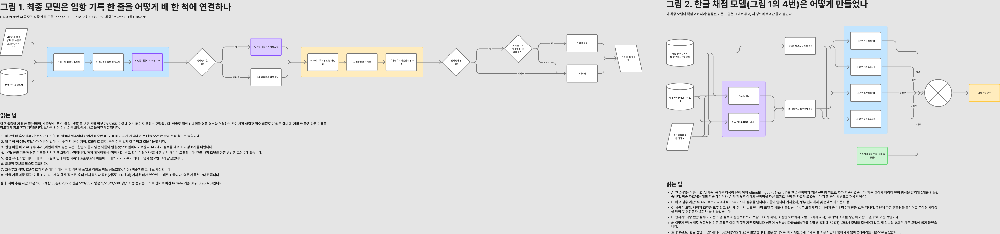

# 최종 모델 hdeltaB (`hdeltaB_e5_e08_noLLM.zip`)

DACON 236771 항만 문제해결을 위한 AI 기술 공모전의 최종 선택 제출이다. 이 문서는 이 모델 하나만 설명한다.

- 제출 ID 122968, 2026-11-01 01:51:45 KST 제출, 팀 12월부산여행
- **Public 0.98395 (15위), Private 0.95376 (31위, 최종)**: 자세한 내용은 [../results/README.md](../results/README.md)
- ZIP 790,664,745 bytes, SHA-256 `1fd1694a6cc6dfeffb145caa579b5c5b230e55cb38fdec1b1cc31a8a1a4dfe09`
- 서버 추론 12분 36초(제한 30분, 공지 418421), 인터넷 없음, 추론 시 LLM 없음



도식 원본(FigJam): <https://www.figma.com/board/7oQbeLVIoMS4t9BKAsl31M>. 그림 1은 아래 2절, 그림 2는 3~4절을 쉬운 말로 그린 것이다.

## 1. 과제

입출항 기록 한 행(선박명, 호출부호, 총톤수, 국제총톤수, 국적, 선종, 입항연도)을 선박 카탈로그 78,595척 중 한 척(`vessel_id`)에 매칭한다. 점수는 0.7 × 한글 선박명 행 정확도 + 0.3 × 비한글 행 정확도다. 한글 행은 카탈로그의 영문 선박명과 표기가 달라 음역 수준의 매칭이 필요하고, 점수 비중도 크다.

## 2. 전체 구조

hdeltaB는 기반 패키지 **E08**에서 **한글 랭커 하나만** 바꾼 것이다. 후보 생성, 비한글 랭커, 후처리, 입출력은 E08과 같은 모델과 코드를 쓴다. E08 대비 바뀐 것은 다음뿐이다.
- `pipeline.py`의 랭커 호출 직전에 넣은 e5 특징 훅 한 곳
- 추가 파일: `bagrank.py`, `e5feat.py`, e5·e5b 인코더 폴더
- 한글 랭커를 바꿔 다시 직렬화한 `artifacts.joblib`

```
test 행 ─► 후보 생성 (톤수 창·음역·음성 키·단어 색인·듀얼 인코더 등, 행마다 독립)
        ─► 쌍 특징 (이름 유사도·음역·톤수·호출부호·국적/선종·인코더 코사인 …)
        ─► + e5 / e5b 특징 8열 (한글 행만, 이번 모델에서 추가)
        ─► LangSplit 랭커
             ├─ 비한글 행: E08 랭커 (LightGBM×2 + CatBoost + LightGBM 혼합, 변경 없음)
             └─ 한글 행:  WeightedRanker (아래 3절)
        ─► 후처리 (톤수 tt, 호출부호 cs 가드) ─► 한글 DE 교체 단계(t=1.0) ─► 1위 후보 = 답
```

각 test 행은 다른 test 행을 참조하지 않는다(행 독립성: 정순·역순·부분집합 실행 결과가 같음을 스모크로 확인).

## 3. 한글 랭커: e5 효과 이식

```
score_ko = S9o
         + 0.5 · (full_e5_e5b     − full_noe5)        # 시드 0,1
         + 0.5 · (full_e5_e5b_s23 − full_noe5_s23)    # 시드 2,3
```

- **S9o**: E08에 들어 있는 출하 한글 랭커(LightGBM lambdarank `lgb_colbag_de3`). 전체 train으로 학습했다.
- **full_noe5 / full_e5_e5b**: S9o와 같은 레시피를 전체 train에 다시 적용해 만든 **쌍둥이** 랭커다. 둘의 차이는 e5·e5b 특징 8열의 유무뿐이다. 각 랭커는 LightGBM 구성원 4개로 되어 있는데, 2개는 88열 대 96열이고 de3 특징을 뺀 2개는 85열 대 93열이다. 학습 행은 2,477,856개다. `_s23`는 같은 구성을 다른 시드(2,3)로 학습한 쌍이다.
- **왜 차이를 더하는가**: 쌍둥이 재현 레시피는 출하 S9o보다 Public 한글이 5~6행 낮았다(full_noe5 515, S9o 521). 그래서 쌍둥이를 그대로 쓰지 않고 **e5 특징이 만드는 점수 변화만** S9o 위에 더했다. 시드 두 쌍을 평균해 차이의 잡음을 줄였다.
- 구현: `submission/model/src/rank/bagrank.py`의 `WeightedRanker`(가중치 1, 0.5, −0.5, 0.5, −0.5). 각 구성원은 자기 학습 열만 골라 쓰므로 S9o는 e5 열을 보지 않는다.

## 4. e5 / e5b 인코더와 특징

- 기반 가중치: `intfloat/multilingual-e5-small`(MIT, 공개 사전학습 가중치).
- 학습: 한글 질의 ↔ 카탈로그 영문명 대조학습(`training/e5_encoder/train_e5.py`). 배치 128, lr 3e-5, 온도 0.05, 코사인 스케줄, 학습 40%·70% 지점에서 어려운 음성 예시 재채굴.

| 인코더 | 단계 | 시드 오프셋 | 증강 | 실행 |
|---|---|---|---|---|
| e5 | 4,000 | 0 | v1 (단어·음절 탈락, 교환, 붙임, 분리) | `run_all.sh` |
| e5b | 6,000 | 1 | v2 (v1 + 영문 선종 접두어) | `run_e5b.sh` |

- 각 인코더는 선박 fold 5개 모델(`_f0`~`_f4`)과 전체 모델(`_f-1`)이 있다. **패키지에는 전체 모델만 들어간다**(`model/e5ko`, `model/e5kob`, 카탈로그 임베딩 `cat.npy` 포함).
- 5-fold 평균 R@1(전체 카탈로그, e5): clean 0.968, shift 0.873.
- 인코더마다 특징 4개(`submission/model/src/rank/e5feat.py`):
  - `cos`: 질의와 후보의 코사인
  - `grank`: 전체 카탈로그 순위(200에서 자름)
  - `gap`: 행 최고 코사인과의 차
  - `rank`: 행 후보 안 순위

  비한글 행에서는 NaN이다.
- 쌍둥이 학습 때 이 특징은 **대상 선박이 속한 fold의 인코더**로 계산했다(`training/twin_rankers/e5parts.py`). 자기가 학습한 선박을 평가하는 누수를 막기 위해서다.

## 5. 기반 E08

E08(`E08_t6_model.zip`, 변형 V18_T6_DE)의 계보는 다음과 같다.

1. **s9c4T_noLLM**: S9o 한글 랭커 + 비한글 랭커. 4B LLM 단계는 뺐다.
2. **s29_t6_l2_c1_n1**: 비한글 랭커만 FittedZAvg[s9pbT6_lab2 ×2, s9pc_rabbrcat, s9pnT_lab345]로 교체했다(원본 작업 저장소의 `build_batch.py`, 이 저장소에는 없음). 한글 랭커 해시는 `426b0241…`로 고정했다.
3. **E08**: 한글 듀얼 인코더 교체 단계 하나(세 인코더 코사인 합 기준, t=1.0)를 추가했다(원본 작업 저장소의 `package_remaining.py`, 이 저장소에는 없음. 해당 로직은 `submission/model/src/rank/submission_variant.py`). 가중치는 바꾸지 않았다.

E08 단독 Public은 0.98132(한글 521/532)다.

## 6. 데이터와 규정 준수

- 학습·검증 원천은 대회 공식 `train.csv`(12,222행)와 `vessel_catalog.csv`(78,595척)뿐이다. 외부 선박 DB나 정답 매핑은 없다.
- 공개 사전학습 가중치는 multilingual-e5-small(인코더), 그리고 학습 데이터 생성에 쓴 LLM이다.
- **학습 계보에 LLM으로 만든 데이터가 있다.** 파일 이름의 "noLLM"은 *추론 시* LLM을 쓰지 않는다는 뜻이다.
  - Qwen3.8-Flash-Next로 train 선박명을 다른 표기로 바꾼 변형(`llmgen41`)이 e5/e5b 학습과 비한글 랭커 일부(s9pbT6, s9pnT) 학습에 쓰였다. 대회 Talk 418501(공식 답변)에서 train 데이터를 이용한 이 방식이 허용되었고, 심사 때 생성 데이터와 코드를 요청받을 수 있다.
  - Qwen3.5-4B의 train OOF 점수(`ft_oof_q35_4b_full.parquet`)가 S9o와 쌍둥이 랭커 학습 특징에 들어가며, 추론 시 이 특징은 NaN이다.
- 추론은 행마다 독립이고, test 분포로 특징을 만들거나 보정하지 않는다.

## 7. 결과와 한계

| 모델 | 한글 랭커 | Public 한글 정답(/532) |
|---|---|---|
| E08 | S9o | 521 |
| hdelta | S9o + e5 효과 | 522 |
| **hdeltaB** | **S9o + e5·e5b 효과, 시드 2쌍** | **523** |
| hdeltaBC / hdeltaBCD | + e5c / + e5c·e5d | 523 / 522 |

- e5 계열 인코더는 둘째(e5b)까지 Public 한글을 1행씩 올렸고, 셋째부터는 늘지 않았다.
- Private(공지 418421 기준 테스트 전체)은 0.95376으로 Public보다 0.030 낮고, 순위는 15위에서 31위로 바뀌었다. 제출별 Private 점수가 공개되지 않아, 다른 후보가 Private에서 더 나았는지는 알 수 없다.
- hdeltaB를 고른 근거는 Public 한글 1~2행 차이였다. 그 차이가 Private에서도 유지되었는지는 확인할 수 없다.

## 8. 재현

[REPRODUCE.md](REPRODUCE.md) 참고. 학습된 모델 파일은 이 저장소에 없으므로, 패키지 재빌드는 모델 파일이 보관된 원본 작업 저장소에서 한다. 재빌드 검증 결과는 [../results/rebuild_check.md](../results/rebuild_check.md)에 있다.
