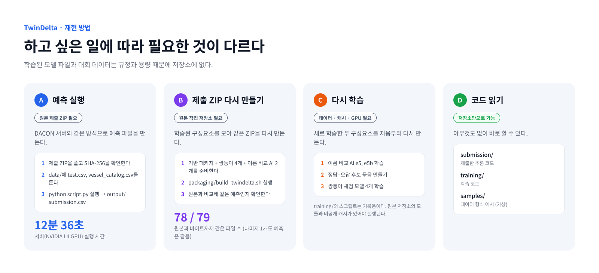

# 재현 방법



| 하고 싶은 일 | 필요한 것 | 이 저장소만으로 |
|---|---|---|
| [A. 예측 실행](#a-예측-실행) | 원본 제출 ZIP, 대회 데이터 | 안 됨 |
| [B. 제출 ZIP 다시 만들기](#b-제출-zip-다시-만들기) | 원본 작업 저장소의 모델 파일 | 안 됨 |
| [C. 다시 학습](#c-다시-학습-참고용) | 대회 데이터, 중간 캐시, GPU | 안 됨 |
| 코드 읽기, 데이터 형식 보기 | 없음 | **됨** |

## 준비

- Python 3.11. 패키지는 [`submission/requirements.txt`](../submission/requirements.txt)를 따른다(rapidfuzz 3.14.6, lightgbm 4.6.0, transformers 5.19.0, torch 2.4 이상, catboost 1.2.10).
- 대회 데이터는 [DACON 데이터 페이지](https://dacon.io/competitions/official/236771/data)에서 받아 `data/`에 둔다. 저장소에는 올리지 않는다.

## A. 예측 실행

DACON 서버와 같은 방식이다.

1. 원본 제출 ZIP `hdeltaB_e5_e08_noLLM.zip`(790,664,745 bytes)을 풀고 SHA-256을 확인한다.

   ```
   1fd1694a6cc6dfeffb145caa579b5c5b230e55cb38fdec1b1cc31a8a1a4dfe09
   ```

2. 푼 폴더 안 `data/`에 `test.csv`와 `vessel_catalog.csv`를 둔다.
3. 실행하면 `output/submission.csv`가 생긴다.

   ```bash
   python script.py
   ```

서버(NVIDIA L4 GPU)에서 12분 36초 걸렸다. 인터넷 없이 실행되며, 패키지는 ZIP 안 `wheels/`에서 설치한다.

> **저장소 코드로 실행하려면** ZIP에서 `artifacts.joblib`, `e5ko/`, `e5kob/`를 꺼내 `submission/model/`에 둔다. 저장소의 `submission/`은 ZIP 안 코드와 같고, 주석 속 선박명과 진단용 상수 하나만 다르다([COMPLIANCE.md](COMPLIANCE.md)).

## B. 제출 ZIP 다시 만들기

재료는 세 가지다. 모두 원본 작업 저장소(로컬, Git LFS)에 있고, 해시는 [`results/MANIFEST.json`](../results/MANIFEST.json)의 `build_inputs`에 있다.

- 기반 패키지 ZIP (후보 찾기, 영문 채점, 규칙이 든 패키지)
- 쌍둥이 한글 채점 모델 4개
- 이름 비교 AI 2개 (e5, e5b)

```bash
ARCHIVE=/path/to/DACON.Ship bash packaging/build_twindelta.sh /path/to/twindelta_rebuild.zip
```

만드는 과정은 [packaging/README.md](../packaging/README.md)에 있다.

**검증 결과** (2026-11-02, [rebuild_check.md](../results/rebuild_check.md))

- ZIP 안 79개 파일 중 78개가 원본과 바이트까지 같다.
- 나머지 `artifacts.joblib`은 저장 순서 때문에 바이트만 다르다. 안의 트리 모델 28개와 예측 결과는 같다.

## C. 다시 학습 (참고용)

[`training/`](../training/)의 스크립트는 당시 실행한 코드를 기록으로 남긴 것이다. 원본 작업 저장소의 다른 모듈과 중간 캐시가 있어야 실행된다.

| 순서 | 스크립트 | 하는 일 |
|---|---|---|
| 1 | `training/e5_encoder/run_all.sh` → `train_e5.py` | 이름 비교 AI e5 학습 (4,000단계). 선박 5묶음별 모델과 전체 모델 |
| 2 | `training/e5_encoder/run_e5b.sh` → `train_e5.py` | 이름 비교 AI e5b 학습 (6,000단계) |
| 3 | `training/twin_rankers/build_full.py` | 전체 학습 데이터로 정답·오답 후보 묶음 5개 만들기 |
| 4 | `training/twin_rankers/e5parts.py` | 후보 묶음에 이름 비교 AI 점수 붙이기 (누수 방지) |
| 5 | `training/twin_rankers/fit_full.py` | 쌍둥이 채점 모델 4개 학습 |

5번 명령 (원본 작업 저장소에서):

```bash
python -X utf8 fit_full.py --e5 0                                        # 새 점수 제외 (시드 0,1)
python -X utf8 fit_full.py --e5 0 --seeds 2,3,2,3 --tag _s23             # 새 점수 제외 (시드 2,3)
python -X utf8 fit_full.py --e5 1 --extra e5b                            # 새 점수 포함 (시드 0,1)
python -X utf8 fit_full.py --e5 1 --extra e5b --seeds 2,3,2,3 --tag _s23 # 새 점수 포함 (시드 2,3)
```

**공개하지 않은 것**

- 기반 패키지와 기존 한글 채점 모델을 만든 스크립트. 대회 데이터 일부가 담긴 실험 기록과 섞여 있다.
- 학습에 쓴 중간 캐시. 대회 데이터에서 만든 것이고, LLM이 만든 선박명 변형과 합성 데이터도 포함된다.
- 이 자료들은 대회 심사 때 요청받으면 낼 수 있도록 원본 작업 저장소에 보관한다.
