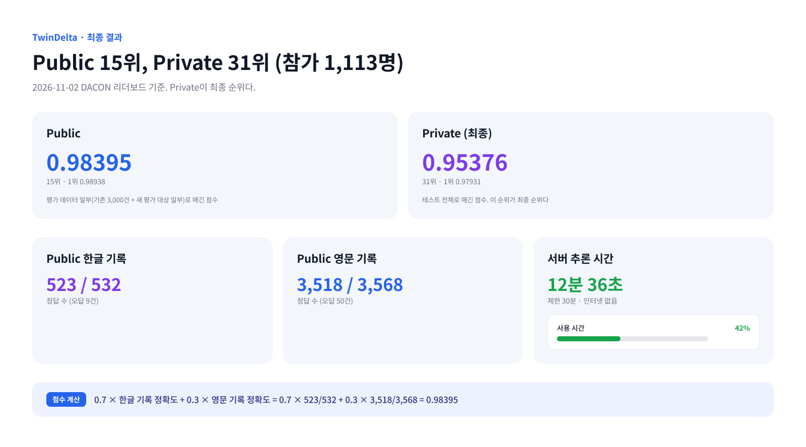

# TwinDelta 최종 결과

- 대회: DACON 236771 항만 문제해결을 위한 AI 기술 공모전
- 팀: 12월부산여행
- 최종 선택 모델: TwinDelta (제출 파일 `hdeltaB_e5_e08_noLLM.zip`, 제출 ID 122968, 2026-11-01 01:51:45 KST)
- 확인: 2026-11-02, DACON 리더보드(Public/Private 탭)

## 점수와 순위

| 구분 | 점수 | 순위 | 1위 | 6위 |
|---|---|---|---|---|
| Public | 0.9839538589 (리더보드 0.98395) | 15 | 0.98938 | 0.98714 |
| **Private (최종)** | **0.95376** | **31** | 0.97931 | 0.97146 |

- **평가식:** 0.7 × 한글 선박명 정확도 + 0.3 × 영문 선박명 정확도
- **Public 풀이:** 한글 523/532, 영문 3,518/3,568. 0.7 × 523/532 + 0.3 × 3518/3568 = 0.98395386으로 점수와 정확히 맞는다. 오답은 한글 9건, 영문 50건이다.
- **Private:** 한글·영문 행 수가 공개되지 않아 행 수로 풀지 않는다.
- **평가 세트(공지 418421):** Public은 기존 3,000건 + 새 평가 대상 일부, **Private은 테스트 전체**다.
- **추론:** 서버에서 12분 36초(756초, 제한 30분). ZIP 790,664,745 bytes.

## 리더보드 화면 (2026-11-02)

| Public 15위 | Private 31위 |
|---|---|
|  |  |

| 파일 | 내용 |
|---|---|
| [01_public_top.jpg](screenshots/01_public_top.jpg) | Public 리더보드 상단(1~8위) |
| [02_public_rank15.jpg](screenshots/02_public_rank15.jpg) | Public 탭을 아래로 내린 화면, 15위(0.98395) |
| [03_private_top.jpg](screenshots/03_private_top.jpg) | Private 리더보드 상단(1~8위) |
| [04_private_rank31.jpg](screenshots/04_private_rank31.jpg) | Private 탭을 아래로 내린 화면, 31위(0.95376). 탭 표시는 03에서 확인 |

로그인하지 않은 상태에서 캡처했다.

## 이 폴더의 파일

| 파일 | 내용 |
|---|---|
| `leaderboard_public_top31.csv`, `leaderboard_private_top31.csv` | 2026-11-02 리더보드 상위 31팀 (우리 팀은 `is_ours=1`) |
| `MANIFEST.json` | 제출 ZIP, ZIP 안 79개 파일, 재빌드 재료의 SHA-256. 경로는 원본 작업 저장소 기준 |
| [`rebuild_check.md`](rebuild_check.md) | ZIP을 다시 만들어 원본과 비교한 결과 |
| `screenshots/` | 위 스크린샷 4장 |
