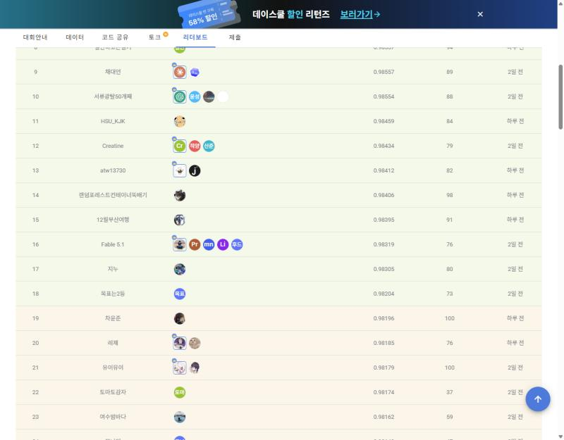
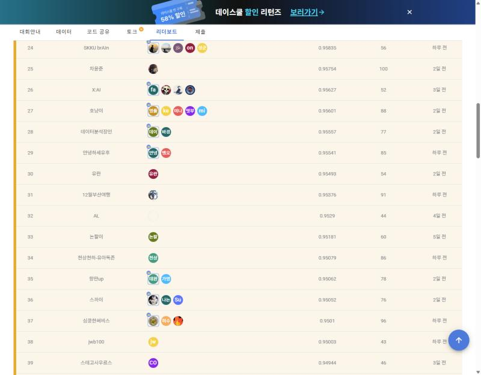
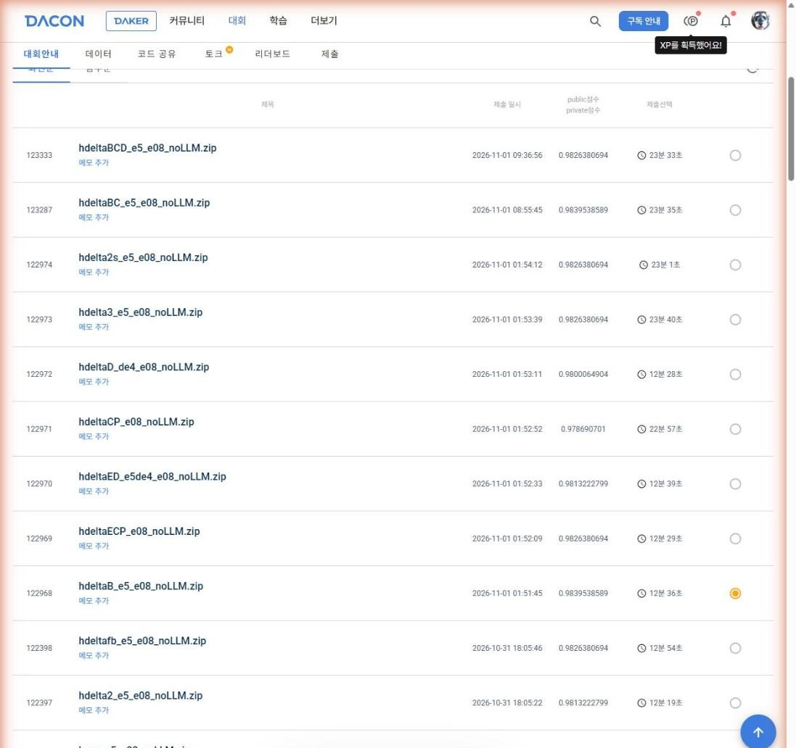

# hdeltaB 최종 결과

대회: DACON 236771 항만 문제해결을 위한 AI 기술 공모전 (선박 입출항 기록 → 선박 카탈로그 매칭)
팀: 12월부산여행 · 최종 선택 제출: `hdeltaB_e5_e08_noLLM.zip` (DACON 제출 ID 122968, 2026-11-01 01:51:45 KST)
확인: 2026-11-02, 로그인된 DACON 리더보드(Public/Private 탭)와 나의 제출 API(`code-submission/list`)

## 점수와 순위

| 구분 | 점수 | 순위 | 1위 | 6위 |
|---|---|---|---|---|
| Public | 0.9839538589 (리더보드 0.98395) | 15 | 0.98938 | 0.98714 |
| **Private (최종)** | **0.95376** | **31** | 0.97931 | 0.97146 |

- 평가식: 0.7 × 한글 선박명 정확도 + 0.3 × 비한글 선박명 정확도.
- Public 해독: 한글 523/532, 비한글 3,518/3,568 (0.7·523/532 + 0.3·3518/3568 = 0.98395386, 정확히 일치). 오답은 한글 9행, 비한글 50행.
- Private은 세트의 한글·비한글 행 수가 공개되지 않아 행 수로 해독하지 않는다.
- 평가 세트(공지 418421): Public = 기존 3,000건 + 새 평가 대상 일부, **Private = 테스트 전체**.
- 서버 추론 시간 12분 36초(756초, 제한 30분). ZIP 790,664,745 bytes.
- DACON은 제출별 Private 점수를 공개하지 않는다(2026-11-02 API 응답에서 91건 모두 `private_score` = 0, `dacon_submissions.csv`의 `private_score_api` 열). 알려진 Private 점수는 최종 선택한 hdeltaB의 리더보드 점수 하나뿐이다.
- Public 15위, Private 31위다. 제출별 Private 점수가 없어 이 차이의 원인을 제출 단위로 나눌 수는 없다.

## 같은 계열 제출의 Public 비교 (hdeltaB 선택 근거)

모두 E08 기반이고 한글 랭커만 다르다. 비한글 정답 수는 모두 3,518로 같다.

| 제출 | 한글 랭커 | Public | 한글 정답 |
|---|---|---|---|
| E08_t6_model (기반) | S9o | 0.9813222799 | 521 |
| hdelta_e5_e08 | S9o + (full_e5 − full_noe5), 시드 0,1 | 0.9826380694 | 522 |
| **hdeltaB_e5_e08** | **S9o + ½Σ시드(full_e5_e5b − full_noe5)** | **0.9839538589** | **523** |
| hdeltaBC_e5_e08 | + e5c 인코더 | 0.9839538589 | 523 |
| hdeltaBCD_e5_e08 | + e5c, e5d 인코더 | 0.9826380694 | 522 |

hdeltaB와 hdeltaBC가 동점일 때 대회 규정의 동점 처리 순서는 추론 시간이 짧은 쪽, ZIP이 작은 쪽, 먼저 제출한 쪽이다. hdeltaB는 12분 36초·754MiB·01:51로 hdeltaBC(23분 35초·1,023MiB·08:55)보다 세 기준 모두 앞서 최종 선택으로 유지했다.

## 스크린샷 (2026-11-02)

| 파일 | 내용 |
|---|---|
| [01_public_top.jpg](screenshots/01_public_top.jpg) | Public 리더보드 상단(1~8위) |
| [02_public_rank15.jpg](screenshots/02_public_rank15.jpg) | Public 탭을 아래로 내린 화면, 우리 팀 15위(0.98395) |
| [03_private_top.jpg](screenshots/03_private_top.jpg) | Private 리더보드 상단(1~8위) |
| [04_private_rank31.jpg](screenshots/04_private_rank31.jpg) | Private 탭을 아래로 내린 화면, 우리 팀 31위(0.95376). 화면 위쪽 탭 표시는 03에서 확인 |
| [05_my_submissions_final_selected.jpg](screenshots/05_my_submissions_final_selected.jpg) | 나의 제출 화면, hdeltaB(ID 122968)에 최종 선택 표시(주황색 원) |

리더보드 화면은 로그인하지 않은 상태에서 캡처했고, 나의 제출 화면은 로그인한 상태에서 캡처했다.

## 파일

- `leaderboard_public_top31.csv`, `leaderboard_private_top31.csv`: 2026-11-02 리더보드 상위 31팀(우리 팀 행 `is_ours=1`).
- `dacon_submissions.csv`: 우리 팀 제출 91건(ID, 파일, 제출 시각, Public 점수, API의 Private 점수 칸, 추론 초, 최종 선택 여부).
- `MANIFEST.json`: 제출 ZIP과 79개 내부 파일, 재빌드 입력 파일의 SHA-256. 경로는 원본 작업 저장소 기준이다.
- `rebuild_check.md`: 원본 작업 저장소의 스크립트와 모델로 ZIP을 다시 만들어 비교한 결과.
- `screenshots/`: 위 스크린샷 5장.
