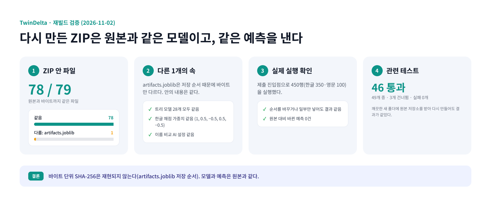

# TwinDelta 재빌드 검증 (2026-11-02)



원본 작업 저장소에서 아래 명령으로 ZIP을 다시 만들었다. 이 저장소의 `packaging/build_twindelta.sh`와 같은 명령이다(원본 저장소에서는 모델을 hdeltaB라는 작업 이름으로 불렀다). 재료는 [MANIFEST.json](MANIFEST.json)의 `build_inputs`와 같다.

```bash
bash final/hdeltaB/build_hdeltaB.sh C:/tmp_rebuild/hdeltaB_rebuild2.zip
```

## 결과

| 검사 | 결과 |
|---|---|
| ZIP 안 파일 79개의 이름 | 같음 |
| `model/artifacts.joblib`을 뺀 78개 파일 (CRC·크기) | 모두 같음 |
| `model/artifacts.joblib` 바이트 | 다름. 다시 만들 때마다 달라지는 저장(피클) 순서 차이다 |
| artifacts 최상위 키 17개 | 같음. 채점 모델이 아닌 15개는 다시 저장해도 바이트까지 같음 |
| 채점 모델 안의 트리 모델 28개 (LightGBM `model_to_string`, CatBoost cbm의 MD5) | 모두 같음 |
| 한글 채점 가중치 | 같음 [1, 0.5, −0.5, 0.5, −0.5] |
| 추론 때 이름 비교 AI 설정 | 같음 [(e5ko, e5), (e5kob, e5b)] |
| 실제 진입점 실행 (`smoke_v2.py`, 450행: 한글 350·영문 100, 정순·역순·일부만) | 두 ZIP 모두 행 독립성 OK. 원본 대비 바뀐 예측 0건 |

**깨끗한 폴더에서 다시 만들기.** 원본 작업 저장소의 `final/hdeltaB` 브랜치를 새 폴더에 받았다. LFS 파일 16개가 복원되었고, 제출 ZIP과 기반 패키지 ZIP의 SHA-256이 원본과 같았다. 같은 폴더에서 다시 만든 결과도 `model/artifacts.joblib` 하나만 CRC가 달랐다(같은 원인).

**관련 테스트.** `tests/test_s4_flags.py`, `test_submission.py`, `test_name_relation_features.py`, `test_f1_key_tr_sort.py`, `test_f2_de_inclusion.py`를 실행했다. 49개 중 46개 통과, 3개 건너뜀, 실패 0개.

> **결론:** 다시 만든 ZIP은 원본과 같은 모델이고 같은 예측을 낸다. 바이트 단위 SHA-256만 재현되지 않는다(`artifacts.joblib` 저장 순서 때문).

## 정리하면서 고친 것

처음 다시 만든 ZIP은 `model/src/rank/pipeline.py`가 원본과 달랐다. `pack_bag.py`가 TwinDelta에서 쓰지 않는 코드 조각까지 끼워 넣었기 때문이다(실행되지는 않지만 바이트가 달라진다). 켜진 옵션의 조각만 넣도록 [`packaging/pack_bag.py`](../packaging/pack_bag.py)를 고친 뒤에는 `pipeline.py`가 원본과 바이트까지 같다.

## 실행 확인 원본 출력

```
hdeltaB_e5_e08_noLLM.zip: row-independent OK
hdeltaB_rebuild2.zip: row-independent OK
clean_ko  rows 150, base err 0, changed 0, fixed 0, broken 0
f38b_krr  rows 50, base err 0, changed 0, fixed 0, broken 0
f38lako   rows 50, base err 0, changed 0, fixed 0, broken 0
latin     rows 100, base err 0, changed 0, fixed 0, broken 0
llmko     rows 50, base err 0, changed 0, fixed 0, broken 0
q32lako   rows 50, base err 0, changed 0, fixed 0, broken 0
```

실행에 쓴 행은 학습에 쓴 배라서 원본 오답이 0이다. 그래서 이 확인은 정확도가 아니라 코드 경로와 예측이 같은지를 본다.
