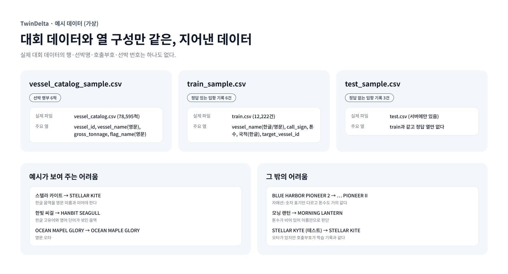

# 예시 데이터 (가상)

이 폴더의 CSV는 **직접 지어낸 가상 데이터**다. 대회 데이터와 열 구성만 같고, 실제 대회 데이터의 행·선박명·호출부호·선박 번호는 하나도 없다.

- 대회 원본 데이터(`train.csv`, `vessel_catalog.csv`, `test.csv`)는 규정에 따라 올리지 않는다. 원본은 [DACON 대회 페이지](https://dacon.io/competitions/official/236771/data)에서 받는다.
- 만든 뒤 모든 가상 선박명과 호출부호가 실제 데이터에 없는지 대조했다.

## 파일

| 파일 | 내용 | 실제 파일 |
|---|---|---|
| `vessel_catalog_sample.csv` | 선박 명부 6척 | `vessel_catalog.csv` (78,595척) |
| `train_sample.csv` | 정답이 붙은 입항 기록 6건 | `train.csv` (12,222건) |
| `test_sample.csv` | 정답이 없는 입항 기록 3건 | `test.csv` (서버에만 있음) |

## 열 설명

**입항 기록** (`train_sample.csv`, `test_sample.csv`)

| 열 | 뜻 |
|---|---|
| `sample_id` | 기록 번호 |
| `vessel_name` | 기록에 적힌 선박명. 한글 또는 영문이고 오타가 있을 수 있다 |
| `call_sign` | 호출부호(익명화된 문자열). 비어 있을 수 있다 |
| `gross_tonnage` | 총톤수 |
| `international_gross_tonnage` | 국제총톤수 |
| `flag_name` | 국적 (한글) |
| `vessel_type` | 선종 (한글) |
| `arrival_year` | 입항 연도 |
| `target_vessel_id` | 정답 선박 번호. 학습 데이터에만 있다 |

**선박 명부** (`vessel_catalog_sample.csv`)

| 열 | 뜻 |
|---|---|
| `vessel_id` | 선박 번호 (맞혀야 할 값) |
| `vessel_type` | 선종 (영문 약어) |
| `vessel_name` | 영문 선박명 |
| `size`, `unit` | 크기 수치와 단위 (DWT, TEU, Passengers 등) |
| `deadweight_tonnage` | 재화중량톤수 |
| `gross_tonnage` | 총톤수 |
| `flag_name` | 국적 (영문) |

## 예시가 보여 주는 어려움

| 기록 | 정답 | 어려운 점 |
|---|---|---|
| `스텔라 카이트` | `STELLAR KITE` | 한글 음역을 영문 이름과 이어야 한다 |
| `한빛 씨걸` | `HANBIT SEAGULL` | 한글 고유어와 영어 단어가 섞인 음역 |
| `OCEAN MAPEL GLORY` | `OCEAN MAPLE GLORY` | 영문 오타 |
| `BLUE HARBOR PIONEER 2` | `BLUE HARBOR PIONEER II` | 자매선: 숫자 표기만 다르고 톤수도 거의 같다 |
| `모닝 랜턴` | `MORNING LANTERN` | 톤수가 비어 있어 이름만으로 판단해야 한다 |
| `STELLAR KYTE` (테스트) | `STELLAR KITE` | 오타가 있지만 호출부호가 학습 기록과 같다 |

국적과 선종이 입항 기록(한글)과 선박 명부(영문)에서 다르게 적힌다는 점도 실제 데이터와 같다.

## 실행해 보기

제출 코드는 `data/test.csv`와 `data/vessel_catalog.csv`를 읽는다. 예시 파일로 흐름만 확인하려면 이름을 바꿔 복사한다. 모델은 실제 명부 전체를 기준으로 학습되어 있어서, 6척짜리 명부로는 실제 정확도를 재현하지 못한다.
