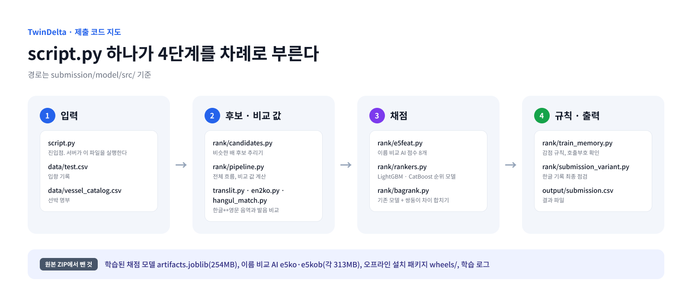

# 제출 코드

최종 모델 TwinDelta의 제출 ZIP `hdeltaB_e5_e08_noLLM.zip`에 들어 있던 추론 코드다. DACON 서버는 ZIP을 풀고 `script.py`를 실행한다.

## 폴더 구성

| 경로 | 내용 |
|---|---|
| `script.py` | 진입점. `data/test.csv`와 `data/vessel_catalog.csv`를 읽어 `output/submission.csv`를 쓴다 |
| `requirements.txt` | 서버에 설치하는 패키지 목록 |
| `model/src/` | 후보 찾기, 비교 값 계산, 채점, 규칙 코드 |
| `model/submission_variant_policy.json` | 한글 기록 최종 점검 설정 (이름 비교 AI 교체, 기준값 1.0) |

## 주요 파일

경로는 `model/src/` 기준이다.

| 단계 | 파일 | 하는 일 |
|---|---|---|
| 후보 · 비교 값 | `rank/candidates.py` | 비슷한 배 후보 추리기 (톤수, 음역, 발음 키, 단어 색인, 이름 비교 AI) |
| | `rank/pipeline.py` | 전체 흐름: 비교 값 계산 → 채점 → 규칙 |
| | `translit.py`, `en2ko.py`, `hangul_match.py` | 한글↔영문 음역과 발음 비교 |
| 채점 | `rank/e5feat.py` | 이름 비교 AI(e5, e5b) 점수 8개 계산 |
| | `rank/rankers.py` | 채점 모델(LightGBM, CatBoost 순위 모델) |
| | `rank/bagrank.py` | 기존 모델 + 쌍둥이 차이를 합치는 `WeightedRanker` |
| 규칙 | `rank/train_memory.py` | 감점 규칙, 호출부호 확인 규칙 |
| | `rank/submission_variant.py` | 한글 기록 최종 점검 (이름 비교 AI 3개 합산 점수로 교체) |

## 원본 ZIP에서 뺀 것

| 원본 ZIP 안 경로 | 뺀 이유 |
|---|---|
| `model/artifacts.joblib` (254MB) | 학습된 채점 모델. 공개하지 않음 |
| `model/e5ko/`, `model/e5kob/` (각 313MB) | 학습된 이름 비교 AI와 선박 명부 임베딩. 공개하지 않음 |
| `wheels/` | 오프라인 설치용 공개 패키지 파일 |
| `model/src/catboost_info/` | 학습 때 생긴 로그 |
| `LLM_MANIFEST.txt` | 예전 LLM 단계의 파일 목록. 최종 제출은 LLM을 쓰지 않는다 |

## 원본과 다른 점

주석 속 실제 선박명을 가상의 이름으로 바꿨고, 진단용 상수 하나를 바꿨다. 최종 예측에는 영향이 없다. 자세한 목록: [../docs/COMPLIANCE.md](../docs/COMPLIANCE.md)
