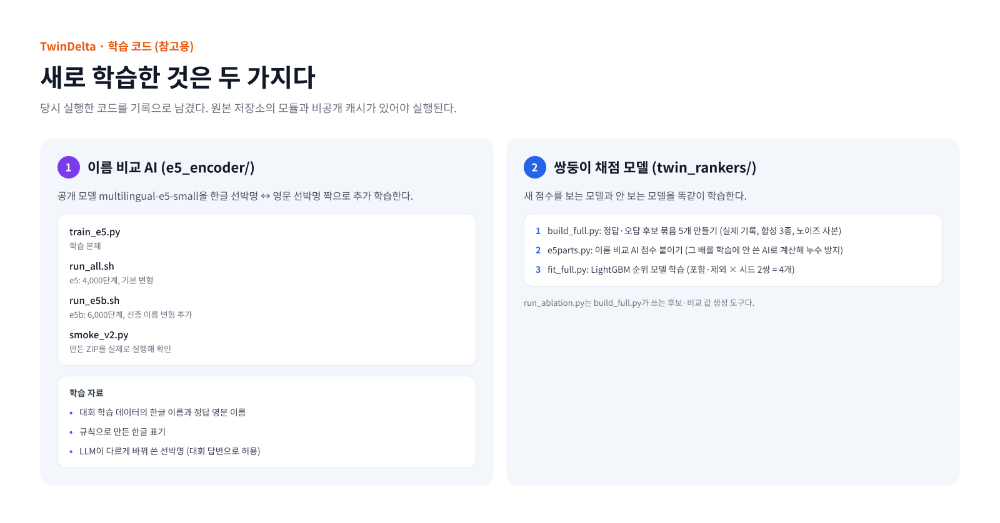

# 학습 코드 (참고용)

TwinDelta에서 새로 학습한 두 구성요소의 학습 코드다. 당시 실행한 그대로 기록으로 남겼다.

> 이 스크립트들은 이 저장소만으로는 실행되지 않는다. 원본 작업 저장소의 `src/`, `experiments/` 모듈과, 대회 데이터에서 만든 중간 캐시(공개하지 않음)가 있어야 한다.

## `e5_encoder/`: 한글↔영문 이름 비교 AI

| 파일 | 하는 일 |
|---|---|
| `train_e5.py` | 공개 모델 `intfloat/multilingual-e5-small`을 한글 선박명 ↔ 영문 선박명 짝으로 추가 학습한다 |
| `run_all.sh` | e5: 4,000단계, 기본 변형. 선박 5묶음별 모델 5개와 전체 모델 1개 |
| `run_e5b.sh` | e5b: 6,000단계, 영문 선종 이름 붙이기 변형 추가 |
| `smoke_v2.py` | 만든 제출 ZIP을 실제 진입점으로 실행해 행 독립성과 예측 변화를 확인한다 |

- **학습 설정:** 배치 128, 학습률 3e-5, 온도 0.05, 코사인 스케줄. 학습 40%·70% 지점에서 헷갈리는 오답 예시를 다시 고른다.
- **학습 자료:** 대회 학습 데이터의 한글 선박명과 정답 영문명, 규칙으로 만든 한글 표기, LLM이 선박명을 다른 표기로 바꿔 쓴 자료(대회 공식 답변으로 허용).

## `twin_rankers/`: 쌍둥이 한글 채점 모델

| 순서 | 파일 | 하는 일 |
|---|---|---|
| 1 | `build_full.py` | 전체 학습 데이터로 정답·오답 후보 묶음 5개를 만든다 (실제 기록, 합성 3종, 노이즈 사본) |
| 2 | `e5parts.py` | 후보 묶음에 이름 비교 AI 점수를 붙인다. 그 배를 학습에 쓰지 않은 AI로 계산해 누수를 막는다 |
| 3 | `fit_full.py` | 기존 한글 모델과 같은 방법으로 LightGBM 순위 모델을 학습한다. 새 점수 포함·제외 × 시드 2쌍 = 4개 |
| - | `run_ablation.py` | `build_full.py`가 쓰는 후보·비교 값 생성 도구 |

실행 명령: [../docs/REPRODUCE.md](../docs/REPRODUCE.md#c-다시-학습-참고용)
